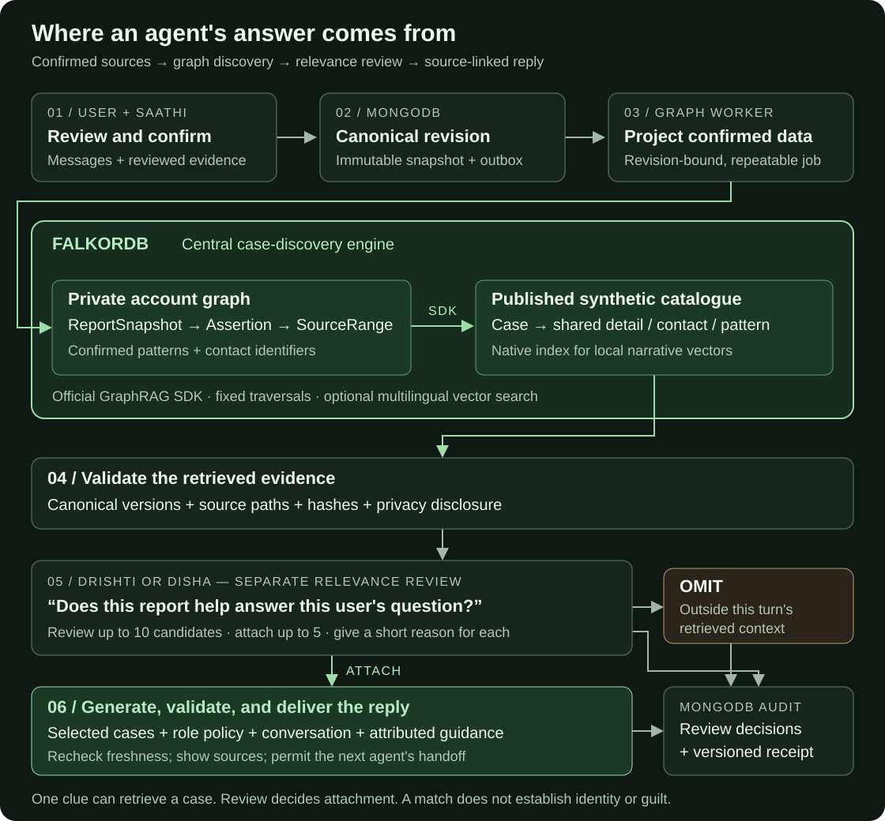
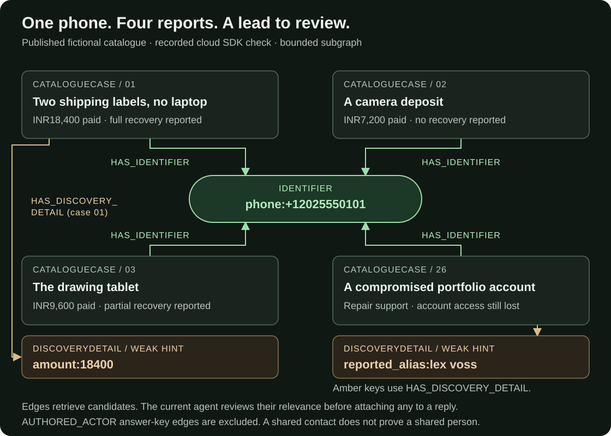

# Yama

**Tell your story. Review the details. Find what connects. Choose your next step.**

Yama helps someone work through a scam, harassment, bullying, or another harmful experience in one shared conversation. **Saathi** helps them explain what happened, **Drishti** looks for useful connections with other reports, and **Disha** helps them consider next steps. They can address an agent directly or let the agents hand the conversation to each other, in English, Hindi, or Hinglish.

**FalkorDB is the case-discovery engine at the centre of Yama.** Its graph supplies the relationships and retrieved reports that agents can review and cite. MongoDB keeps the original accounts, evidence metadata, confirmations, conversations, and decision receipts. A graph match is a lead to examine, never a finding of identity or guilt.

Current stage: a **private localhost demo with synthetic incidents**. This repository does not yet provide a public service for real reports.

## How the graph informs an agent's answer



1. **Saathi helps prepare the account.** Original messages and reviewed evidence retain their source references. Extracted details are proposals until the user accepts them; only the user confirms the account revision.
2. **The graph worker projects that confirmed revision into FalkorDB.** Assertions point back to exact message ranges and evidence hashes. Private graphs are separated by account.
3. **The official GraphRAG SDK retrieves candidates.** The server reads confirmed graph seeds and queries the published synthetic catalogue. One supported contact, amount, item, reported alias, or supported pattern can be enough for discovery. Optional multilingual vector search also finds similar narratives without a literal shared key.
4. **The connection service checks the evidence.** Graph paths, canonical records, content versions, and semantic hashes must agree. Reporter profiles and contacts the user did not already supply are withheld from the comparison.
5. **Drishti or Disha makes a separate relevance decision.** For every retrieved candidate, the role-bound reviewer returns `attach` or `omit` with a short reason. At most ten candidates are reviewed and at most five enter the reply context. A failed review does not attach everything by default.
6. **The selected agent writes a source-linked reply.** Selected candidate records enter that reply's comparison context. The server stores review decisions and a versioned connection receipt; delivery rechecks freshness. Corrections require a new confirmation before fresh comparisons.

The graph determines **what can be retrieved and supported**. The model decides **what is relevant to the question and how to explain it**, under its role policy and server validation. Saathi's intake replies do not require a graph search; Disha can also use dated assistance guidance and separately attributed public sources. General advice is not evidence of a case connection.

### A concrete example from the demo graph



A new account gives a different seller name but includes the fictional phone number **+1 202 555 0101**. Four catalogue reports connect to that `Identifier`: a laptop purchase, a camera deposit, a tablet purchase, and a portfolio account takeover. The phone alone retrieves all four; a shared seller name is unnecessary.

For a question only about purchase losses, the reviewer can omit the account-takeover report even though the phone matches. For lost account access, narrative similarity can retrieve that report even without the phone. **Retrieval and attachment are separate decisions.**

The [read-only cloud subgraph check](docs/design/readme-graph-verification.json) verifies the diagram's four phone matches, two weak-detail edges, and 42 current published vectors. Recorded live synthetic runs demonstrate the relevance decisions:

- [Exact-detail run](docs/design/graphrag-sdk-verification.json): one phone retrieved four reports; a purchase-focused review attached three of five discovered candidates and omitted two.
- [Semantic run](docs/design/semantic-streaming-verification.json): 42 published vectors; the intended account-takeover report ranked first for English, Hindi, and Hinglish probes without an exact shared key. A live review attached one of ten candidates before a streamed reply.

See [the graph schema, decision trail, and read-only Cypher examples](docs/graph-and-agent-decisions.md). These diagrams describe the implemented retrieval path and a bounded synthetic subgraph; they are not an interactive private case-map feature.

## The three agents

| Agent | Responsibility | Information sources |
| --- | --- | --- |
| **Saathi** | Listen, clarify, propose details, and route requests | User messages, reviewed evidence, source-linked proposals, and conversation |
| **Drishti** | Explain relevant reports, matches, differences, and uncertainty | Confirmed FalkorDB results, canonical source checks, and reviewed candidates |
| **Disha** | Discuss next steps and recorded outcomes | Reviewed graph comparisons, dated assistance, and public sources when available |

All three share a conversation and can request handoffs. `@Drishti` addresses Drishti directly; naming an agent in prose routes through Saathi's explicit transfer. The server controls turns, cancellation, permissions, and delivery. Only the user marks a chat resolved or reopens it.

Role instructions: [Saathi](agents/saathi/SKILL.md), [Drishti](agents/drishti/SKILL.md), [Disha](agents/disha/SKILL.md). See [orchestration and shared policies](docs/agent-orchestration.md).

## What is implemented

| Area | Current behaviour / limits |
| --- | --- |
| Chat | Persistent shared conversation, agent addressing, handoffs, typing states, provider streaming, and source previews |
| Reports | Source-linked assertions, corrections, immutable revisions, explicit confirmation, and owner-scoped access |
| Evidence | Private files, SHA-256, bounded text/PDF/image extraction, local English/Hindi OCR, and review before adding draft text |
| GraphRAG | Official FalkorDB SDK, exact-detail and optional local multilingual vector retrieval, and candidate review; no automatic ontology discovery |
| Demo cases | 40 authored reports across seven harm categories plus two baseline fixtures; recurring fictional actors and false-link controls |
| Text models | Fixtures by default; opt-in OpenAI API; signed-in Codex adapter for the private synthetic localhost demo only |
| Voice | Sarvam STT/TTS and LiveKit implemented, transcript review and playback-bound handoffs; disabled pending live Sarvam verification |
| Public lookup | Exa search and Firecrawl page reading, attributed sources and bounded jobs; fixtures by default |
| Email / monitoring | Resend with optional Nodemailer fallback and metadata-only Langfuse adapters; live account verification remains separate |
| Payments | Dodo test-checkout backend, verified webhook inbox, and credit ledger; browser checkout and actual advanced paid analysis pending |

Voice prepares short audio replies before playback and requires transcript review. It is not yet a seamless duplex conference call. Two female voices and one male voice are configured. The account owner reports model training disabled, but Sarvam retention remains unverified; it must not be described as zero retention.

Private visual maps, reviewed PDF/DOCX exports, DigiLocker/police partnerships, and public launch remain deferred. The commercial proposal is approximately 30% of advanced details free, then $10 for ten more. Current entitlement content is synthetic test material, not something to sell. Essential assistance and private victim information stay outside the paywall.

## Architecture

| Layer | Technology / responsibility |
| --- | --- |
| Application | Next.js 16 App Router, React, TypeScript, Tailwind CSS, Motion |
| Identity and transactions | Better Auth and a MongoDB replica set |
| Case graph | FalkorDB private account graphs and a separate published synthetic catalogue |
| Retrieval | `graphrag-sdk==1.4.0`, fixed parameterised traversals, native FalkorDB vector index |
| Local embeddings | Pinned `intfloat/multilingual-e5-small`, 384 dimensions, CPU inference; no embedding API key |
| Agents | Python coordinator, role skills, bounded provider adapters, MongoDB jobs and receipts |
| Voice | Sarvam Saaras v4 / Bulbul v3, local LiveKit, separate Python voice worker |
| Optional services | Exa, Firecrawl, Resend/Nodemailer, Langfuse, Dodo test mode |

MongoDB is the canonical record store. FalkorDB is a rebuildable but central retrieval projection: confirmed assertions and provenance are queryable there, while uploads, chat history, auth, billing, and decision receipts stay in their appropriate stores. Real private reports are **not** automatically published into cross-account discovery. The catalogue's `AUTHORED_ACTOR` edges are an evaluation answer key, excluded from runtime matching and model context.

Workers are long-lived processes. Deploying the Next.js frontend to Vercel alone will not provision the workers, Python runtime, local embedding model, or private storage.

The root [Dockerfile](Dockerfile) packages the API and workers for a Node/Python container host. Its explicit `hosted-demo` mode accepts an HTTPS frontend origin and authenticated MongoDB Atlas settings while retaining synthetic-only use. Startup validates configuration, and `/api/health` checks both databases. See [Render settings, readiness troubleshooting, and remaining deployment changes](docs/render-docker.md) before deploying; Vercel API forwarding and hosted voice/evidence integration still need work.

## Run the localhost demo

Use **Node 24** (`.nvmrc`), **Python 3.11+**, and compatible Colima/Lima/Docker/Compose tools. Local container binaries are ignored. GraphRAG dependencies may require C++ build tools. Credentials belong server-side in the ignored `.env.local`.

```sh
npm ci

# Generate local secrets before SDK setup; preserve an existing .env.local.
npm run db:setup
npm run db:up
npm run agents:setup
sh scripts/setup-graphrag.sh
npm run evidence:setup
npm run db:init
npm run db:seed-demo

# Optional: download the pinned local model and index the published catalogue.
.venv-graphrag/bin/python scripts/setup-semantic.py
npm run db:index-semantic

npm run dev
```

Run these in separate terminals:

```sh
npm run worker:graph
npm run worker:evidence
npm run worker:agents
```

Open **http://127.0.0.1:3000**. Start with a fictional account from [the recording script](docs/demo-video-script.md), review **Your notes**, and confirm before asking Drishti for comparisons. **Ask a question** discusses the confirmed account; adding or correcting details creates a new draft revision. Uploading a file alone does not add its contents or confirm the account.

Fixtures work without paid calls. For generated replies, configure [the OpenAI adapter](docs/openai-extraction.md) or [the local signed-in Codex adapter](docs/local-codex-provider.md). Codex consumes the existing account's allowance and must not be exposed in a public deployment.

### Local or cloud FalkorDB

Fresh setup uses local FalkorDB. Cloud mode explicitly selects server-side cloud credentials; it does not replace MongoDB or upload storage.

```sh
# Read-only: inspect the active connection.
npm run db:check-graph

# Check saved cloud credentials without switching the active target.
npm run db:check-graph -- --cloud

npm run db:status
npm run db:down
```

Set `YAMA_GRAPH_TARGET=cloud` only after configuring `YAMA_CLOUD_FALKORDB_*` and checking the instance's actual TLS setting. Restart the app and workers after changes. See [.env.example](.env.example) and [credentials and cloud selection](docs/credentials-setup.md). Never commit `.env.local`, API keys, passwords, native account sessions, or `.local` data.

Optional setup: [voice](docs/voice-integration.md), [public lookup](docs/public-web.md), [notifications](docs/notifications.md), and [Dodo test billing](docs/billing.md). These have separate worker/configuration steps.

## Verify changes

```sh
# TypeScript, lint, frontend/backend unit tests, and a production build.
npm run check

# Python coordinator/provider contracts; no paid calls.
.venv/bin/python -m unittest discover -s tests -q
.venv-graphrag/bin/python -m unittest discover -s tests/graphrag -q

# Optional voice SDK checks after voice:setup; in-memory transports.
npm run test:voice
```

Integration tests require initialized local databases, the parser image, and a fixture-mode app. Stop the regular graph, evidence, agent, voice, web, mail, and billing workers; tests drive their own workers. Keep local LiveKit running for synthetic transport checks. See [the demo test guide](docs/demo-testing.md):

```sh
# Application terminal:
YAMA_TEXT_PROVIDER=fixture npm run dev

# Test terminal; isolate graph tests from the cloud instance:
YAMA_GRAPH_TARGET=local YAMA_TEXT_PROVIDER=fixture npm run test:integration
```

Recorded checks and screenshots are dated evidence, not a guarantee that every provider is live: [GraphRAG](docs/design/graphrag-sdk-verification.json), [semantic retrieval and streaming](docs/design/semantic-streaming-verification.json), [desktop](docs/design/semantic-chat-desktop.png), and [mobile](docs/design/semantic-chat-mobile.png).

## Read more

- **Graph and decisions:** [schema and decision trail](docs/graph-and-agent-decisions.md), [SDK integration](docs/graphrag-sdk-integration.md), [semantic retrieval](docs/semantic-search-and-streaming.md), [connection explanations](docs/connection-explanations.md).
- **Demo:** [recording story](docs/demo-video-script.md), [casebook](docs/demo-casebook.md), [seeding and matching](docs/synthetic-case-dataset.md), [walkthrough](docs/demo-walkthrough.md).
- **Backend:** [architecture and recovery](docs/backend-architecture.md), [API contract](docs/backend-api.md), [service sequence](docs/backend-services.md), [document processing](docs/document-evidence.md).
- **Agents:** [orchestration](docs/agent-orchestration.md), [dispatcher](docs/agent-dispatcher.md), [proposal review](docs/agent-proposal-review.md), [dialogue/handoffs](docs/text-dialogue.md), [assistance](docs/assistance-actions.md).
- **Design:** [shared rules](DESIGN.md), [component sources](docs/component-review.md), [selected components](docs/design/action-components/README.md), [wireframe brief](docs/wireframe-brief.md), [editable wireframes](docs/design/yama-wireframes.excalidraw), [tool map](docs/design/yama-tool-map.excalidraw).
- **Planning:** [implementation plan](docs/implementation-plan.md), [providers](docs/third-party-services.md), [proposed tools/maps/exports](docs/agent-tool-catalogue.md), [verification matrix](docs/verification-matrix.md), [original context](docs/product-context.txt).

Before real reports: review safeguarding, child-consent workflows, access/recovery, retention/deletion, backups, India-only provider data handling, and production security. Current demo controls do not establish public-launch readiness.

## Component and artwork credits

[BeautifulUI](https://www.beautifului.dev/) supplies the chat/AI primitives; [beUI](https://beui.dev/) informed discovery; [Aceternity UI](https://ui.aceternity.com/components/magnetic-button) supplies the adapted button style. Folder, Matrix Orb, Web Search, and Voice Note come from [Rare UI](https://rareui.com) by Swami Malode. Its MIT + Commons Clause + Attribution notice is preserved in [licenses/RareUI.txt](licenses/RareUI.txt). See [component review](docs/component-review.md) and [ASCII Magic artwork](assets/artwork-check/README.md) for provenance. Third-party notices apply to their respective assets/components; this README does not grant a new licence to the application.
