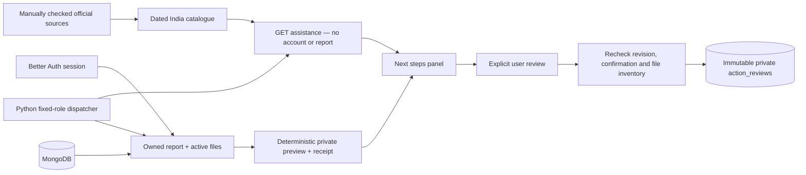

# Dated assistance and private action review

Implemented 2026-10-11 for synthetic localhost incidents. Next steps now displays official assistance independently of authentication/report confirmation/payment, and a server-built private summary/evidence manifest. The supplied BeautifulUI Approval Card records an explicit review. Saving a draft does not confirm assertions or file a complaint.



## Assistance contract

`GET /api/assistance?language=en|hi|hinglish` requires neither authentication nor a report. It returns `free: true`, explicit jurisdiction `IN`, version `india-assistance-2026-10-11`, and three authored options. No private incident content, arbitrary URLs, category inference or model instructions are accepted. This is a curated local catalogue, not a live lookup or eligibility decision.

Primary sources checked on **2026-10-11**:

- India-wide emergency response number 112: police/health/fire assistance. [Ministry of Home Affairs](https://www.mha.gov.in/en/commoncontent/emergency-response-support-system-erss).
- National cybercrime reporting portal and 1930 assistance; the financial-fraud scope is also identified by NCH. [MHA statement published by PIB, 12 August 2026](https://www.pib.gov.in/PressReleasePage.aspx?PRID=2298336&lang=1&reg=3), [NCH](https://consumerhelpline.gov.in/public/about).
- NCH portal or 1915 for consumer grievances, a pre-litigation route. [Department of Consumer Affairs](https://consumerhelpline.gov.in/public/about).

The cybercrime and 112 websites did not load reliably during research, so their information was corroborated against the ministry/PIB sources above. This does not verify call availability or actual complaint filing. No legal conclusions, deadlines, criminal classification, recovery guarantees or specialist safeguarding workflow are supplied. The catalogue does not cover every incident category.

Each option carries fixed official-service/source links, scope, checked date and **2027-01-09 UTC review deadline**. Outside that interval, the server returns `needs_review`, removes contact recommendations from body/contact fields, and the UI withholds the service-action button. Historical source links remain for checking current details. Refresh content, version and dates together after a new manual source check. Translations use the same bounded claims; official sites determine their own requirements/languages.

External anchors use `noopener noreferrer` and `no-referrer`, with no report parameters. Contacting a service remains a separate user action. No remote lookup or outbound submission runs on a user's request.

## Private preview and review

`GET /api/reports/:id/actions` reads an owned report and active files in a Mongo snapshot. It returns recipe `private-actions-v1`, revision/language/confirmation, `verification: not_independently_verified` and `submitted: false`.

- Summary: included statements, original/corrected values, polarity, origin/agent provenance, exact quote and UTF-16 source range. Contradicted/uncertain statements retain their labels. Excluded statements contribute IDs to the omission list, not summary entries. Original source quotations may contain other details; this private preview is not an externally shareable redacted export.
- Manifest: active files, names, formats, sizes, byte SHA-256, document-text hash where available, processing state and text-review status. Historical reviewed sources survive archival and are labelled unavailable. This is stored metadata, not a fresh byte-integrity check or proof of authenticity. Existing evidence source reads retain their separate hashing checks.
- Receipt: SHA-256 over deterministic preview content, including revision, confirmation and sorted file metadata. It is not an access credential; every private call requires the owned session.

`POST /api/reports/:id/actions` accepts exactly:

```json
{"expectedRevision": 1, "receipt": "<64-character SHA-256>", "acknowledged": true}
```

A majority-write/snapshot transaction rebuilds the preview, rejects stale revision/receipt, writes fences on the report/active files and saves one immutable `action_reviews` record per report/receipt. Concurrent corrections, uploads, extraction or archival force retry and recheck. Identical retries return the original timestamp. Later report/file changes display `unreviewed`; old review never authorizes new content. Confirmation can change without revision, so it is also hashed. No graph projection, model call, entitlement or external side effect is created.

Private routes use Better Auth, `private, no-store`, exact Origin, existing 128 KiB JSON cap and account rate limit. No owner selector, client-authored summary or submission flag is accepted. Generic failures expose no driver errors, credentials or report content.

The browser polls visible previews every five seconds, aborts superseded reads, preserves disclosure/focus and resets acknowledgement when a receipt changes. Failure never displays success. The persisted application uses server previews; the unsaved visual demo retains its local text-download fixture. PDF/DOCX exports remain increment 8.

## Agent boundary and verification

Ten read/preview tools are connected. New: `lookup_verified_assistance` (all roles), `find_reporting_options` and `propose_next_actions` (Disha). They accept no arbitrary arguments and retain lease/role/owned-report checks without requiring confirmation. Guidance/private draft are re-fetched before cached delivery; changes stale the task. The combined action tool returns the same server preview plus guidance. Existing summary/manifest tools remain read-only local previews; the new combined receipt is the application approval boundary.

Agents cannot call POST review, confirm, file, send or purchase. The text model still returns bounded dialogue/handoff output; unrestricted model-selected execution is not enabled. The sourced panel and review are deterministic services. No new SDK, provider request, credential or cost was introduced.

Tests cover languages/expiry, Hindi sources/corrections/negative evidence, deterministic receipts, duplicate/concurrent approval, ownership, wrong Origin, forged inputs, stale files/revisions, file-change races, rollback, keyboard acknowledgement and response validation. See [verification record](assistance-actions-verification.json).

Historical private reviews are retained with report/evidence history. Recovery, purge, retention and staff safeguarding require their own work before real reports. Review is neither independent verification nor official filing.

Next: **Sarvam/LiveKit voice**, with two female/one male assignments, English/Hindi/Hinglish, actual playout acknowledgement, interruption/reconnection and text fallback using the same report/coordinator. Exa/Firecrawl, exports, mail and Dodo stay in later isolated increments. Credentials remain deferred to account setup.
