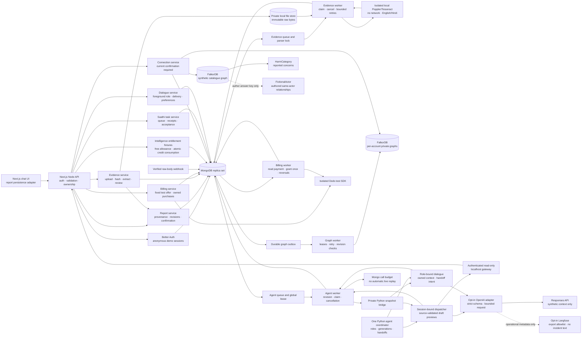

# Database and backend foundation

Implemented 2026-10-08 for synthetic localhost use and connected to the frontend on 2026-10-09. MongoDB is the canonical application store; FalkorDB is a rebuildable graph of confirmed revisions. This replaces the earlier PostgreSQL plan and the earlier note proposing FalkorDB as the primary incident store. The frontend keeps presentation state locally and restores report/conversation data from authenticated endpoints.

17 October: cloud FalkorDB is active through `YAMA_GRAPH_TARGET=cloud`; its credentials have been authenticated. TLS certificates are verified when TLS is selected, but this supplied instance uses plain TCP and explicitly sets `YAMA_CLOUD_FALKORDB_TLS=false`. Its earlier DNS failure cleared after the user restarted it. The initial cloud migration copied 27 catalogue entries and rebuilt 27 confirmed snapshots; the later v3 refresh has 40 authored cases plus two baseline fixtures. The app, MongoDB and upload storage remain local, and local graphs are preserved. See [connection setup](credentials-setup.md), [initial migration verification](design/cloud-graph-verification.json) and [current cross-harm verification](design/cross-harm-demo-verification.json). The subsequent [official GraphRAG SDK integration](graphrag-sdk-integration.md) now handles indexed candidate retrieval, followed by a separate role-bound review before reply generation.

## Architecture

For the current graph schema and the complete retrieval → relevance review → reply path, see [FalkorDB and agent decisions](graph-and-agent-decisions.md). That guide includes a concrete shared-contact subgraph, read-only Cypher examples, and the private decision/receipt trail. The broader service map below covers the supporting application services.



Use a modular monolith, graph/evidence/agent workers and two databases. Evidence queue state stays in MongoDB; only the document parser is isolated in a short-lived container. Keep providers behind service adapters. Do not add separate services for every agent or a new queue server at this stage. The later Python voice worker is separate because the existing LiveKit/coordinator integration is Python.

The v3 synthetic catalogue has 40 accounts across seven reported-harm categories. `AUTHORED_ACTOR` edges encode seven recurring fictional actors as an author/evaluation answer key; connection retrieval does not traverse these edges or send the key to the model. `HAS_HARM` labels a reported concern, including concerns later cleared, rather than a legal finding. The API and role context carry validated harm categories while retaining source-based contact matching and unverified identity linkage. See [the casebook and false-link controls](demo-casebook.md).

Dialogue context keeps a 24,000-character limit. When retrieved prose exceeds that budget, its narrative excerpts are shortened before failing. All five selected matches, exact source quotes, reported outcomes and the user's corrections remain intact. Full records in MongoDB and the interface are not shortened.

## Source of truth and collections

| Collection | Owns | Important controls |
| --- | --- | --- |
| `reports` | Current report, original messages, proposed/corrected assertions, revision, user confirmation | Owner filter on every read/write; unique owner + creation key; bounded messages/assertions |
| `report_revisions` | Immutable draft and confirmed snapshots | Unique owner/report/revision/kind; written in the same transaction as the current report |
| `evidence` | Owned file metadata, SHA-256, processing claims, frozen text/receipt and reviewed message reference | Unique report/upload key and report/content hash; transactional 20-slot report quota; three parser attempts; token-guarded completion |
| `evidence_worker_lock` | Single parser lease across evidence workers | 90-second lease; token-guarded release; bounded runtime before recovery |
| `agent_tasks` | Owned Saathi extraction jobs, provider-bound hashed previews and accepted references | Transactional 20-task lifetime quota, fixed role/frozen provider settings, token/revision checks; explicit acceptance with draft snapshot; live calls are not replayed after an expired claim |
| `dialogues` | One owned foreground conversation per report, preferences, assistant history and current generation/delivery receipts | Revision/version transactions; 20 starts, 60 replies, 3 speakers per chain; handoff only after acknowledged text delivery; old generation results discarded |
| `agent_worker_lock` | Single extraction/dialogue subprocess lease across workers | 45-second lease, token-guarded release; 25-second process deadline |
| `provider_budgets` | Shared lifetime OpenAI call reservations | Atomic configured 1–100 call ceiling across reports; failures/crashes retain reservations; no automatic replenishment |
| `graph_outbox` | Projection jobs bound to a confirmed revision | Atomic confirmation + job insertion; claim token, 30-second lease, five attempts, capped exponential backoff |
| `catalogue` | Authored public-safe synthetic examples | Explicit synthetic/published checks; no user-report publication endpoint |
| Better Auth collections | Anonymous users, sessions, accounts, verification and auth rate limits | Unique tokens/email; session/verification expiry indexes; HTTP-only, SameSite cookies |
| `billing_purchases`, `billing_events` | Owned fixed checkout receipts and minimal signed webhook inbox | Ledger isolation, stable creation keys, bound provider sessions, duplicate delivery IDs and bounded read-only verification |
| `billing_grants`, `billing_accounts`, `billing_reversals`, `billing_consumptions` | Account credits and transactional consumption/reversal history | Ten once per purchase, serialized spending, reversal tombstones and no client balance writes |
| `intelligence_batches`, `intelligence_accesses` | Authored entitlement fixtures and owned unlocked detail references | Thirty percent free, locked body redaction, confirmed revision/source freshness and active-grant checks |
| `api_limits` | Per-account API request limits | Atomic fixed-minute counter, 120 requests/minute, expiry cleanup |

MongoDB is a single-member authenticated replica set so transactions are real. Confirmation saves the current report, an immutable confirmed snapshot, and a graph job together. A failed job insertion rolls all three back. Transactions are necessary across documents; MongoDB's single-document atomicity alone would not cover that boundary. [MongoDB atomicity](https://www.mongodb.com/docs/v8.0/core/write-operations-atomicity/)

Application credentials have `readWrite` on the Yama database. Root credentials are used only by explicit bootstrap/integration-test commands. The local `.env.local` holds both sets for this demo and is ignored with mode 0600; split bootstrap secrets from application deployment configuration before a public environment.

## Report lifecycle

1. Create a synthetic report with an authenticated session and UUID idempotency key. The server assigns all report, message, and assertion IDs. Reusing a key with different content returns 409.
2. Preserve the original message exactly, including Hindi script and whitespace. Source ranges use JavaScript UTF-16 offsets into that message. Client-supplied proposals are labelled `client_proposal`. Accepted durable Saathi previews are labelled `agent_proposal`, with trusted task/adapter metadata; model output cannot commit them itself. Assertions remain `not_verified`.
3. Add messages, propose assertions, or correct their current value/inclusion/polarity using `expectedRevision`. Preserve the original value and source. A successful edit increments the revision and clears confirmation. Concurrent edits cannot silently overwrite each other.
4. Explicitly acknowledge the current revision. User confirmation is a review action, not independent verification. Repeating confirmation is idempotent. There must be at least one included assertion.
5. The worker projects the immutable confirmed snapshot. A stale revision is superseded, not projected as the current report. A crash after graph writing can be retried without duplicating the projection.
6. Connection reads require current confirmation and a completed projection, then recheck the report after the graph query. Editing while the query runs returns a revision conflict.

Revisions are preserved for audit; excluding or correcting an assertion does **not** erase its historic snapshots. Current discovery never reads those old revisions. Deletion/retention/purge workflows across both stores remain a later required service.

## Graph and disclosure boundary

Each account's graph name contains a hash of its server-resolved owner ID. `ReportSnapshot` → `Assertion` → `SourceRange` records revision-specific provenance. Approved, included, affirmed pattern tags connect snapshots to `Pattern` nodes. Contradictory or uncertain claims for a tag prevent that tag from supporting a match. Graph properties include private assertion text, so these graphs stay server-only.

The separate catalogue graph contains only authored synthetic cases and their pattern tags. User reports are never projected there. Parameterized read-only Cypher finds shared tags; MongoDB supplies only published synthetic descriptions. Results expose patterns, differences and explicit linkage limits. There is no identity/entity resolution, vector retrieval, probability score, or allegation verification yet. Pattern comparison against fictional examples is the implemented scope.

No request can supply raw Cypher, a Mongo operator, an owner ID, a verification status, or a confirmation state. A graph path is not an authorization grant. Future cross-report discovery needs an explicit publication/disclosure policy; account partitioning must not be removed merely to make search easier.

FalkorDB transport uses the official client's Graph/command implementation with bounded node-redis transport. Version 6.8.0's connection factory can emit errors before a caller attaches a listener, so a small adapter registers that listener first. It uses two internal exports; the package is pinned, with real integration tests required before upgrading. Queries have a three-second server timeout; socket/connect timeouts are five seconds. [Official TypeScript client](https://github.com/FalkorDB/falkordb-ts)

Increment 4 adds [source-linked explanations](connection-explanations.md), validates graph provenance against Mongo, fingerprints fictional catalogue content and binds Drishti delivery to current sources. The publication boundary remains fictional-only.

## Local runtime and recovery

```sh
npm run db:setup
npm run db:up
npm run evidence:setup
npm run db:init
npm run dev
# In separate terminals:
npm run worker:graph
npm run worker:evidence
npm run worker:agents
```

The dedicated Colima `yama` profile reserves 2 CPUs and 2 GB RAM, with sparse 12 GB root/data disks. MongoDB is capped at 768 MB with a 256 MB WiredTiger cache; FalkorDB is capped at 640 MB with a 384 MB Redis memory target and no eviction. MongoDB's former 640 MB cap was OOM-killed during concurrent test load; the revised cap leaves health-check headroom. Frontend tests run one worker and integration tests run separately. These are demo settings, not production sizing. Both images are digest-pinned. MongoDB is 8.0.32; FalkorDB is 6.0.1.

MongoDB listens only on `127.0.0.1:27018`; FalkorDB on `127.0.0.1:6380`. The pre-existing Redis on 6379 is untouched. FalkorDB's browser port is not published. Named volumes preserve database data across container restarts. Nothing in `db:down` deletes volumes.

```sh
npm run db:status
npm run db:down
# Stop the VM to release its reserved RAM:
.local/runtime/bin/colima stop yama
# After db:up, recover failed jobs or rebuild a lost graph:
npm run db:requeue-graph
npm run worker:graph
```

Requeue resets eligible current-confirmed jobs, skipping active leases. The worker rechecks current revision/confirmation, so edits made during requeue still invalidate old work. Restart the worker after a lost database connection. Regular graph failures retry automatically within the attempt limit.

This machine uses official CLI binaries in ignored `.local/runtime/bin` because Homebrew does not supply the required bottles for its macOS version. On another machine install compatible Colima, Lima, Docker CLI and Compose, or use the official binary instructions; the control script accepts either workspace-local or PATH binaries. Do not copy runtime binaries into source control. [Colima installation](https://colima.run/docs/installation/), [Docker binary installation](https://docs.docker.com/engine/install/binaries/)

## Verification and limits

`npm run check` runs type checking, lint, frontend/backend unit tests, and the production build. With databases initialized, the parser image built and the dev server on the configured origin, run `npm run test:integration`. Stop all three long-running workers during that suite so pending-state assertions and cleanup are deterministic; the tests exercise their own worker instances. Integration tests use generated isolated test database/graph namespaces and new anonymous HTTP sessions. Cleanup removes only those test namespaces/session-owned records. A native Node bootstrap test also verifies additive, repeatable setup. Tests make no provider calls.

Coverage includes optimistic concurrency, duplicate creation, transaction rollback, original wording, source bounds, strict payloads, cross-account reads/writes/confirmation, request limits in size, same-origin mutations, confirmation invalidation, actual graph traversal, negative evidence, stale-query checks, retry idempotency, expired leases, bounded failures, and private/catalogue separation. The Python coordinator retains its separate offline tests.

The foundation's 2026-10-08 verification passed 114 tests and verified database restart recovery. [Foundation verification](backend-verification.json). The connected frontend increment passed 78 frontend, 11 backend unit, 21 real integration/runtime and 29 offline coordinator tests (139 total), plus type checking, lint and production build. Browser create/correct/confirm/compare/refresh and narrow Hindi review also passed. [Connected frontend verification](frontend-persistence-verification.json)

The plain-text evidence increment passed 88 frontend, 19 backend unit, 34 real integration/runtime and 29 offline coordinator tests (170 total). Type checking, lint and a production build are included in its [verification record](evidence-verification.json). Browser source review, revision invalidation, confirmation, actual graph comparison, refresh restoration and Hindi at 320 px were checked; native file selection remains a manual check because the in-app chooser API timed out.

The document/OCR increment passed 91 frontend, 22 backend unit, 51 real database/HTTP/runtime and 29 offline coordinator tests (193 total), plus type checking, lint and a production build. Browser checks covered durable pending work, real Hindi OCR, receipt-bound approval, revision invalidation, confirmation, graph comparison, refresh and 320 px Hindi layout. An actual parser container was inspected for network/mount/user/resource isolation. [Document verification](document-evidence-verification.json).

The durable agent/browser increment passed 107 frontend, 28 backend unit, 78 database/HTTP/runtime and 69 Python coordinator/dispatcher tests (282 total), plus type checking, lint and production build. The real browser flow covered exact sources, subset acceptance, separate correction/confirmation, graph matches, refresh, keyboard focus and a 320 px Hindi review. [Agent review verification](agent-proposal-review-verification.json).

The OpenAI extraction/metadata-only Langfuse increment passed 108 frontend, 35 backend unit, 85 database/HTTP/runtime and 87 Python coordinator/dispatcher/provider SDK tests (315 total), plus type checking, lint, production build, pinned SDK setup and additive schema initialization. Official SDKs used in-memory HTTP/export transports; no paid provider requests were made. Existing fixture provenance and corrections still render in the browser. [Provider verification](openai-extraction-verification.json) · [configuration and limits](openai-extraction.md).

Anonymous sessions are authenticated demo ownership, not verified identities, recoverable production accounts, consent, or staff access. Session expiry/lost cookies can make a demo report inaccessible; account linking/recovery is a separate milestone. Synthetic flags declare the permitted mode; they cannot prove a user supplied fictional content. Keep this localhost-only until real-report controls exist.

The frontend now uses these APIs. Its comparison subscription resumes after refresh; comparison cancellation only stops watching results. Original messages, corrected assertions, owned text/document files and frozen OCR receipts are persisted. Static agent hints, voice preview and interface preferences remain local. File review creates a draft revision; uploading or extracting alone leaves confirmation unchanged. Confirmed private graph source ranges carry the file ID, byte SHA-256 and document text/page receipt. [Evidence foundation](evidence-service.md), [document contract and verification limits](document-evidence.md).

The PDF/image increment adds local isolated extraction/OCR, a durable worker and frozen provenance to the review flow. See [document contract](document-evidence.md) and [runtime isolation receipt](document-evidence-runtime.json). The Python coordinator now connects to report/evidence/connection APIs through a [session-bound read-only dispatcher](agent-dispatcher.md): fixture proposals, Disha draft summaries/manifests and actual Drishti graph comparisons. This backend flow is integration-tested with scripted delivery acknowledgements. The [Saathi browser flow](agent-proposal-review.md) now queues durable Mongo receipts, invokes the dispatcher through private snapshot IPC and accepts selected proposals atomically into a new draft. Confirmation stays separate. [Text dialogue](text-dialogue.md) now persists all three agent roles, language/preferences and generation-bound delivery/handoffs, using fixtures or the existing optional OpenAI adapter and metadata-only Langfuse. Live account verification is deferred until keys. Full-text/vector/entity linkage, reviewed exports, voice, email, entitlements, payments, backups, retention/purge and public launch remain separate increments. See [service sequence](backend-services.md) and [API contract](backend-api.md).

The subsequent text-dialogue increment passed 118 frontend, 35 backend unit, 102 database/HTTP/runtime and 96 Python tests (351 total), plus type checking, lint and production build. The browser verified the three-agent chain, persisted reply IDs/active role, Hindi and handoff preferences. Provider tests remain offline; keys are deferred. [Dialogue verification](text-dialogue-verification.json) · [contract and limits](text-dialogue.md).


Increment 5 adds the [dated assistance and action review service](assistance-actions.md): public essential India guidance, owned server previews and transactional immutable private reviews in `action_reviews`. It reuses session/Origin/limits and existing report/evidence write boundaries; no graph schema or additional provider was introduced. Voice is the next isolated increment.

See [billing.md](billing.md) for test checkout, webhook and credit boundaries. Advanced-detail bodies are authored fixtures; actual advanced analysis and browser purchase controls remain pending. Maps and reviewed exports remain deferred.

The Mongo container explicitly allows 65,536 open file descriptors. The full integration suite exhausted the earlier default while creating isolated schema/index namespaces, causing MongoDB to abort with `TooManyFilesOpen` during eventfd creation. Container recreation preserves the existing volume; the 768 MiB memory limit and 256 MiB WiredTiger cache remain unchanged.
