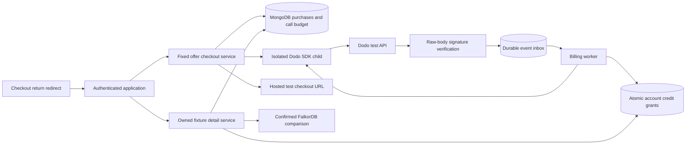

# Dodo test checkout and account credits

Implemented 2026-10-14 for the synthetic localhost demo. `dodopayments@2.54.2` is installed. The default is a local fixture ledger with no provider requests. The only external billing mode is **Dodo test mode**; live charging is not available in configuration.

The fixed offer is **$10 USD for ten additional details**, inclusive of tax. Credits belong to the signed-in account. One distinct protected detail consumes one credit; repeating its unlock or reading it again costs nothing. Existing Connections, essential assistance, reports, evidence and private victim information remain free.

The new detail catalogue is **authored entitlement test material**, labelled `authored_entitlement_fixture`. A currently confirmed report and actual, source-validated graph comparison produce a batch of twenty access-control fixtures when permitted fictional matches exist; six are free, fourteen are protected. An empty comparison produces zero details. These cards are not generated intelligence, fresh evidence or real incident findings. Actual advanced analysis, its pricing/value review and browser checkout controls are separate work. Do not sell these fixtures.

## Architecture and trust boundary

The application fixes price, currency, quantity and product. It sends Dodo only a random local purchase reference and the public offer ID in metadata. It supplies no reporter identity, incident text, evidence, account cookie or saved payment method. Billing details entered on the hosted page belong to Dodo's own account/data-handling review. SDK output is reduced to session/URL or payment verification fields; customer, address, card and arbitrary metadata fields are discarded. Webhooks retain a body hash and selected event/payment/business references, not their raw payload.

Creation persists an owned purchase before calling Dodo. The adapter reads the product and permits only a one-time $10 USD tax-inclusive SKU without discounts, dynamic pricing, purchasing-power pricing, native credit entitlements or licence fulfilment. It creates a hosted session with quantity one, coupons/currency selection disabled, and a stable provider idempotency key. Only the exact `https://test.checkout.dodopayments.com/session/<stored-session>` destination can be returned. No API directly confirms or charges a saved card. [Dodo checkout integration](https://docs.dodopayments.com/developer-resources/checkout-session), [checkout API](https://docs.dodopayments.com/api-reference/checkout-sessions/create).

The provider return route always redirects to the clean application root. Query parameters cannot create credits or supply an account/payment reference. A Dodo SDK signature/timestamp check over the original bounded UTF-8 body must succeed before an event enters MongoDB. Delivery IDs are unique per ledger; a changed payload under the same ID returns a conflict. Unsupported signed event types are acknowledged without creating jobs. An inbox persistence failure returns an error so the provider can retry. [Dodo webhooks](https://docs.dodopayments.com/developer-resources/webhooks).

The worker retrieves the payment from the authenticated **test API** and compares merchant, purchase metadata, stored session, payment ID, USD total of 1000 minor units, exact SKU and quantity, and absence of subscription/payment-method-update state. Browser payment claims and webhook metadata alone never authorize a grant. A transaction creates ten credits once per purchase/payment and marks the event complete. A separate account fence serializes grant, reversal and spending across reports.

Refund success and opened/accepted/lost disputes revoke the purchase's remaining credits and previously paid access. A refund before payment success leaves a tombstone, preventing later events from granting credits. The adapter conservatively treats any reported refund status or dispute history as a reversal; partial refunds also suspend the whole grant. Resolved disputes do not restore it automatically. There is no refund-creation endpoint in this increment.

Locked preview responses contain no body or source reference. Unlock requires the owned batch/detail, current confirmed revision, receipt and explicit acknowledgement. Consumption and access are transactional and key-bound; concurrent requests cannot spend the last credit twice. Current source publication/version is rechecked, with write fencing against a concurrent withdrawal. The internal source fence does not change its semantic content version. A report edit or source change makes the old batch stale before it can spend credits.

## HTTP contracts

All responses are private/no-store. Mutations except the signed provider webhook require the application's exact origin and a Better Auth session. IDs are server-generated UUIDs. Fields are strict; clients cannot select prices, accounts or balances.

| Endpoint | Contract |
| --- | --- |
| `GET /api/billing/offer` | Fixed test-only public offer |
| `POST /api/billing/checkouts` | `{key: UUID, acknowledged: true}`; owned purchase receipt |
| `GET /api/billing/checkouts/:id` | Owned purchase status; checkout URL only while ready/unexpired |
| `POST /api/billing/checkouts/:id/fixture-complete` | `{acknowledged: true}`; fixture-only signed event, no immediate grant |
| `GET /api/billing/balance` | Current ledger's available/purchased/revoked counts |
| `POST /api/billing/webhook` | Raw JSON ≤128 KiB; SDK-verified standard webhook headers; durable acceptance |
| `GET /api/billing/return` | Clean-root redirect; ignores all parameters |
| `GET /api/reports/:id/intelligence` | Current owned fixture batch, six of twenty free |
| `GET /api/reports/:id/intelligence/:batch/:detail` | Free or previously unlocked current detail; otherwise 402 |
| `POST /api/reports/:id/intelligence/:batch/:detail/unlock` | `{key: UUID, expectedRevision, receipt, acknowledged: true}`; detail plus `charged: 0|1` |

The Python agents have no checkout, charge, credit grant or unlock capability. Text/voice autonomous tool selection and browser purchase/detail controls were not added. The existing dispatcher and frontend continue to use the free report/connection/action services.

## Local setup and future sandbox verification

`npm run billing:setup` preserves existing environment settings, writes a random fixture signing key and keeps `.env.local` at mode 0600. `npm run db:init` installs additive validators/indexes. Run `npm run worker:billing` alongside the application. Default fixture completion goes through the same signature-verified inbox and worker, without a card page or network request.

For a later explicitly configured Dodo sandbox check, provide:

- `DODO_PAYMENTS_API_KEY`: test account token.
- `DODO_PAYMENTS_WEBHOOK_KEY`: test endpoint signing secret.
- `DODO_PAYMENTS_PRODUCT_ID`: eligible fixed one-time tax-inclusive $10 USD product.
- `DODO_PAYMENTS_BUSINESS_ID`: matching test merchant ID.
- `YAMA_BILLING_PROVIDER=dodo_test`, `YAMA_DODO_TEST_ENABLED=true`, `YAMA_DODO_DATA_POLICY_ACKNOWLEDGED=true`, with `YAMA_DEMO_ONLY=true` retained.

Restart the app and worker after configuration. External webhook registration requires a separately reviewed HTTPS endpoint/tunnel; none was exposed or registered here. Subscribe to payment succeeded/failed/cancelled, refund succeeded, and dispute opened/accepted/lost. Test payment, duplicate delivery, refund and access revocation deliberately before enabling a user-facing purchase flow. Fixture credits and Dodo test credits are separate ledgers.

The default lifetime admission budget is fifty test API request reservations, capped at 200 by validation. Checkout reserves two requests; each payment verification reserves one. Reservations are retained after errors. There are at most twenty purchases per account/ledger, three worker verification attempts, a global worker lease and a 20-second child deadline. Dodo SDK automatic retries are disabled; only read-only verification may retry. No account subscription, free balance, automatic recharge or provider spend ceiling was assumed or changed.

A checkout whose provider outcome is unknown is never automatically reposted, including after a crash or config change. If the hosted session reference was not persisted, webhook verification cannot fulfil it automatically. Operator reconciliation with Dodo is required; no reconciliation UI is implemented. Production needs provider reconciliation, verified identity/recovery, ledger audit/retention, jurisdiction/eligibility review, compatible India-only handling and release security review. Anonymous demo cookies are not durable account recovery. No live billing or real reports are supported.

## Verification

Unit tests cover fixed offer/config/destination gates and source-version stability. Actual installed SDK tests use fake transports to verify test-mode paths, product checks, payload privacy and no automatic retries. MongoDB tests cover signed events, timestamp/signature failure, duplicates, mismatched payment fields, refund ordering, interrupted verification, worker concurrency, budgets and credit races. HTTP tests use real anonymous sessions and FalkorDB projection for checkout, worker grant and detail access. No external Dodo API request or charge was made. Counts and checks are recorded in [billing-verification.json](billing-verification.json).

Private visual maps and reviewed PDF/DOCX exports remain deferred by the user.
