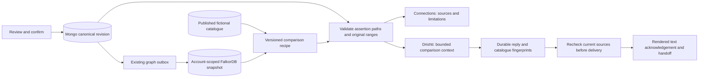

# Source-linked connection explanations

Implemented 2026-10-11, increment 4, for the synthetic localhost demo. Connections and Drishti use the same comparison service. No additional provider, key or model call was added.



## Contract

`GET /api/reports/:id/connections` requires an owned session, current confirmation and completed projection. `202 pending` contains no findings. Ready results include `recipe: confirmed-pattern-sources-v1`, revision, pattern-source records and up to ten fictional candidates. Shared-tag count is overlap only; `linkage.status` stays `not_assessed`.

Each path resolves the confirmed snapshot's shared tag to supporting assertion IDs and exact original message ranges. The separate catalogue is joined by tag in application code; this is not an edge connecting people. Its sources are authored fictional examples, never external case citations. Mongo supplies canonical quotes, current/original values, correction status, proposal origin, Saathi adapter metadata and reviewed evidence/text hashes.

Actual `HAS_ASSERTION`/`SOURCED_FROM` paths and pattern membership are checked against Mongo: IDs, values, origin, inclusion, polarity, UTF-16 ranges and hashes. Missing/altered paths or pattern edges fail as `projection_invalid`; missing snapshots fail closed. Catalogue SHA-256 fingerprints are checked against the graph; stale content fails as `catalogue_changed`. Report revision is rechecked after graph reads.

| Source state | Interpretation |
| --- | --- |
| supporting | Included/affirmed; no included negative or uncertain statement for this tag |
| blocked | Affirmed but another included statement disputes/questions the tag |
| contradicted | Included negative evidence |
| uncertain | Included uncertainty |
| excluded | User omitted it; cannot support a match |

Withheld sources remain visible even for zero matches. Confirmation is not independent verification. Item differences use included affirmed assertions and authored catalogue fields. An unshared tag is not proof of contradiction.

## Dialogue and delivery

The worker supplies confirmed Drishti turns with the same comparison. Unconfirmed, pending, ready-empty and ready-match states stay distinct. Fixtures describe actual tags/counts in English, Hindi and Hinglish. The opt-in OpenAI adapter receives a bounded summary of titles, tags, differences, withheld states and fixed linkage limit, plus existing owned context. No owner/report/message/file IDs, graph names, queries or credentials enter the comparison context. Titles/narration remain untrusted input.

The existing context cap, shared budget, strict schema, `store:false`, cancellation and metadata-only Langfuse remain. Structured output constrains shape; live prose accuracy requires evaluation. [Official Structured Outputs guide](https://developers.openai.com/api/docs/guides/structured-outputs?api-mode=responses).

Server-created `connectionReceipt` binds recipe, report revision and cited catalogue fingerprints. The worker rechecks after generation; conversation reads/delivery acknowledgements check confirmation and cited publication/content. Changed sources invalidate ready text and handoffs. Delivered history retains its receipt. **View comparison sources** fetches current results; older report-revision replies do not offer it. Historical catalogue bodies are not yet snapshotted.

The dispatcher connects `explain_connection` as a read-only Drishti capability, with no query/owner arguments. Cached graph tasks are rechecked before delivery. `query_connection_paths`/`compare_entities` remain future capabilities. Models cannot confirm, write, publish or initiate external actions.

## Setup and verification

Run `npm run db:init` to refresh fictional catalogue fingerprints. Reports/revisions are preserved; no new collection or credentials are needed. Keep the existing three workers running.

Run `npm run check`, `.venv/bin/python -m unittest discover -s tests -q`, then `npm run test:integration` separately with normal workers stopped. [Verification record](connection-explanations-verification.json) covers corruption/missing paths, negative evidence, catalogue withdrawal/change, ownership, stale generation/delivery, languages, SDK serialization and keyboard/accessibility checks.

An isolated browser fixture is available after a production build:

```sh
node --conditions=react-server --import tsx --env-file=.env.local scripts/preview-connections.ts
```

Open `http://localhost:4100`. It generates a disposable Mongo/graph namespace, forces fixtures/monitoring off, starts separate workers/server and cleans only its namespace when stopped. The user's application database is never selected. Browser verification corrected the deliberate amount mismatch, withheld an uncertain tag, confirmed the synthetic revision and inspected exact sources. [Screenshot](design/connection-sources-browser.jpg).

## Disclosure and next increment

Publication is limited to validated fictional fixtures. Private reports never enter the catalogue; there is no staff/agent publication endpoint. Real publication requires vetted disclosure/redaction, immutable catalogue history, approval/revocation transactions and publication fences before cross-account discovery. Bootstrap is not that workflow. Identity inference, safeguards, regional handling and production security remain separate launch work.

Next: increment 5, dated sourced assistance and reviewed Disha actions. Start with curated guidance and deterministic summary/evidence-manifest previews. Essential assistance stays independent of confirmation/payment. External searches, official filing, outbound mail and checkout remain later increments.
