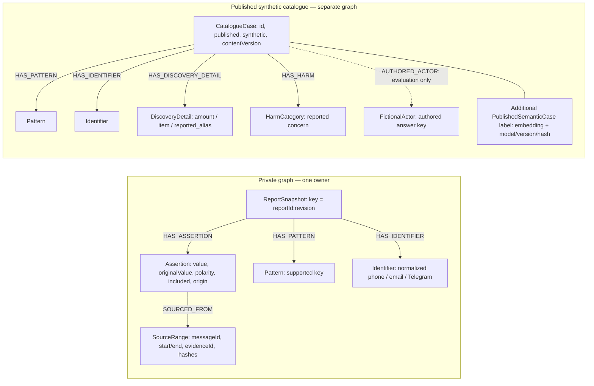

# FalkorDB: the graph and the agent decision trail

FalkorDB is central to **finding related reports and explaining the basis of a comparison**. It does not replace the canonical application records in MongoDB or decide whether an allegation is true. The application builds a source-linked graph from a user-confirmed revision, retrieves candidates through the official GraphRAG SDK, checks those candidates against canonical records, and asks the current specialist to review relevance before generating a reply.

## Retrieval and decision flow


```mermaid
flowchart TD
    U["User account + reviewed evidence"] --> S["Saathi: source-linked draft proposals"]
    S --> C["User confirms this revision"]
    C --> M[("MongoDB: canonical revision + graph outbox")]
    M --> W["Graph worker: revision-bound projection"]
    subgraph F["FalkorDB — central case-discovery engine"]
        P[("Private account graph: confirmed snapshot + provenance")]
        K[("Published synthetic catalogue: detail edges + vector index")]
    end
    W --> P
    P --> Q["Official GraphRAG SDK: exact seeds + optional narrative vector"]
    Q --> K
    K --> V["Connection service: canonical versions, source paths, disclosure"]
    M -. "Canonical records" .-> V
    V --> R["Drishti / Disha relevance review: at most 10 candidates"]
    R -->|"attach: at most 5"| A["Role-bound reply generation"]
    R -->|"omit"| O["Excluded from this turn's comparison context"]
    R --> D[("MongoDB: private candidate-review decisions")]
    A --> T["Validated reply + case/version receipt"]
    T --> E["Freshness check, source-linked delivery, permitted handoff"]
    X["Dated guidance / optional public lookup"] -. "Separately attributed" .-> A
    classDef graph fill:#17382b,stroke:#8bd3a0,color:#eef9f0;
    class P,K graph;
```

Arrows between the private graph, SDK, and catalogue describe **application data flow**, not cross-account graph relationships. No query traverses directly from one owner's private graph into another owner's graph.

## Actual graph schema

Each owner has a graph named `<database>_private_<owner-hash>`. The explicitly published synthetic catalogue has a separate graph named `<database>_catalogue`.



`PublishedSemanticCase` is an **additional label on the same catalogue node**, not a separate node or an `embedding` relationship. Its native vector index stores the 384-dimensional local narrative embedding. `HAS_HARM` describes a reported concern, including concerns that may later be cleared; it is not a legal finding.

All assertion records remain visible in private provenance, including excluded or negative material. Only eligible supporting assertions supply positive traversal seeds. In the current schema, private patterns and identifiers are graph edges; amount/item/alias query keys and semantic query text are derived from canonical confirmed assertions by the application. They are not silently added as new private graph node types.

## A real synthetic subgraph


This bounded view was checked against the cloud instance with read-only queries: [subgraph verification](design/readme-graph-verification.json). The earlier [SDK verification](design/graphrag-sdk-verification.json) exercises its discovery keys. It is an illustration of those records, not a live dashboard.

| Catalogue ID | Title | Graph discovery basis |
| --- | --- | --- |
| `synthetic-demo-01-gadget-laptop` | Two shipping labels, no laptop | `phone:+12025550101`; also `amount:18400` |
| `synthetic-demo-02-gadget-camera` | A camera deposit before the wedding season | `phone:+12025550101` |
| `synthetic-demo-03-gadget-tablet` | The drawing tablet and a second clearance fee | `phone:+12025550101` |
| `synthetic-demo-26-cyber-account-takeover` | The repair desk and a compromised portfolio account | `phone:+12025550101`; also `reported_alias:lex voss` |

All names, contacts, businesses, and incidents here are invented. Contact equality does not establish that different aliases belong to the same person. The fixture's authored actor membership is deliberately unavailable to retrieval and model review, so it cannot leak the expected answer.

### Read-only inspection

Use the selected instance's graph browser or an authenticated read-only query against `<database>_catalogue`. These queries require no model and perform no writes.

```cypher
// Show the shared phone and its reports as a graph.
MATCH (c:CatalogueCase)-[edge:HAS_IDENTIFIER]->(i:Identifier)
WHERE c.synthetic = true AND c.published = true
  AND i.key = 'phone:+12025550101'
RETURN c, edge, i
```

```cypher
// Inspect the two weak keys separately from the shared phone.
MATCH (c:CatalogueCase)-[edge:HAS_DISCOVERY_DETAIL]->(d:DiscoveryDetail)
WHERE c.synthetic = true AND c.published = true
  AND d.key IN ['amount:18400', 'reported_alias:lex voss']
RETURN c, edge, d
```

```cypher
// Check how many current published narrative vectors are queryable.
MATCH (c:CatalogueCase:PublishedSemanticCase)
WHERE c.synthetic = true AND c.published = true
  AND c.semanticVersion = c.contentVersion
RETURN count(c) AS currentPublishedVectors
```

The recorded 18 October check contained 42 vectors: 40 authored reports and two baseline fixtures. Reindexing or publication changes can change that count.

## What an agent actually decides

| Step | Decision maker | Input and output |
| --- | --- | --- |
| Include / correct a detail | User through the report service | A source-linked draft assertion; never automatic confirmation |
| Confirm a revision | User through the report service | A confirmed MongoDB revision plus durable projection job |
| Retrieve candidate cases | Server + official GraphRAG SDK + FalkorDB | Confirmed seeds / optional local query vector → at most ten prioritized catalogue matches |
| Validate and disclose | Connection service | Canonical hashes, source paths, versions, privacy view → valid bounded candidates or an explicit failure |
| Attach / omit each candidate | Current Drishti or Disha role, through a separate model call in live mode | User question, assertions, shared details, disclosed summaries, outcomes → one short decision per candidate |
| Explain / suggest / hand off | Reply model + server coordinator | Selected case context, conversation, role policy, separately attributed guidance → schema-validated reply and permitted handoff |
| Resolve a chat | User | Resolved/unresolved state; independent of any model response |

Fixture mode uses deterministic review rules rather than a model call. The source of a decision must be described accurately for the selected provider.

The reviewer must cover every candidate exactly once; missing, duplicated, invented, or oversized decisions fail validation. A single weak match is enough to **ask whether it is useful**, not enough to attach it automatically. Exact contacts rank ahead of weaker hints; semantic-only candidates follow exact candidates. Similarity scores are retrieval hints, not identity probabilities.

### Trace a reply to its sources

The server maintains this chain:

```text
confirmed report revision
  → Assertion → SourceRange (original quote / evidence hashes)
  → graph traversal keys and/or version-bound semantic retrieval
  → canonical candidate + contentVersion + disclosed evidence
  → dialogue_candidate_reviews: attach/omit + short reason + candidate version
  → selected reply context
  → connectionReceipt: recipe + report revision + selected case IDs/versions
  → freshness-checked delivery and source views
```

`dialogue_candidate_reviews` is private server-side audit data, not a public graph or a model's hidden chain of thought. The receipt records which selected reports were supplied, not that every generated sentence is automatically verified. The explanation and original source quotations are what a user can inspect. Generated history does not become confirmed evidence, and older history may still contain previously delivered comparisons; omission removes a candidate from the **current turn's retrieved comparison context**.

Observed examples:

- The [purchase-focused live review](design/graphrag-sdk-verification.json) attached the laptop, camera, and tablet accounts. It omitted the account-takeover account because the question excluded that type, and a rental account whose only relevant overlap was an amount.
- The [account-access live review](design/semantic-streaming-verification.json) attached the account-takeover account and omitted nine other semantic candidates. Its reason cited repair support, a recovery-email change, lost portfolio access, and unauthorized client payment requests, while leaving shared identity unestablished.

These are recorded outputs for particular questions and revisions, not hardcoded outcomes for every future conversation.

## Implementation references

| Code | Responsibility |
| --- | --- |
| [graph.ts](../src/server/database/graph.ts) | Private snapshot projection, catalogue edges, and confirmed seed reads |
| [graph_retrieval.py](../yama_agents/graph_retrieval.py) | Official `RetrievalStrategy`, exact traversal, native vector query, ranking and limits |
| [graphrag.ts](../src/server/database/graphrag.ts) | Bounded Python SDK bridge and typed retrieval output |
| [semantic.ts](../src/server/reports/semantic.ts) | Eligible query text, disclosed catalogue text, model revision and hashes |
| [connections.ts](../src/server/reports/connections.ts) | Canonical/source validation, disclosure, linkage wording and comparisons |
| [candidate_review.py](../yama_agents/candidate_review.py) | Role-bound relevance instructions and complete decision validation |
| [dialogue/runtime.ts](../src/server/dialogue/runtime.ts) | Reviewer invocation, attachment filtering and bounded reply context |
| [dialogue/worker.ts](../src/server/dialogue/worker.ts) | Review orchestration, durable decisions, receipts and stale-result rejection |
| [dialogue/service.ts](../src/server/dialogue/service.ts) | Owned delivery, receipt checks and handoff state |

Setup, latency, model provenance, publication boundaries, and SDK test commands are in [the SDK guide](graphrag-sdk-integration.md) and [semantic retrieval verification](semantic-search-and-streaming.md). Raw uploads, auth/billing records, full chat history, and private review decisions are not all stored in FalkorDB. Public cross-account reporting and private visual maps require separate work.
