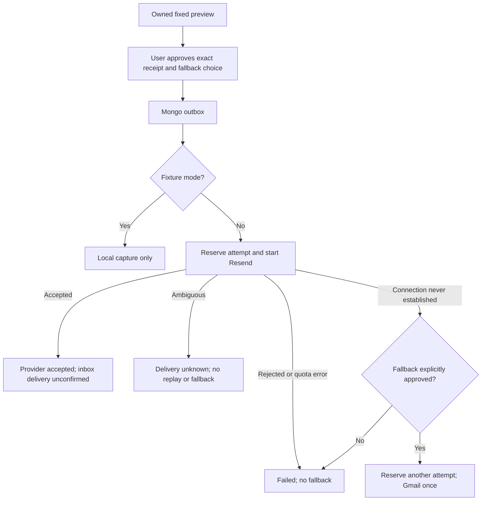

# Notification service

Increment 9, implemented 2026-10-14. The user deferred private maps and PDF/DOCX exports. This increment adds an owned notification preview, explicit application approval, a durable MongoDB outbox, pinned Resend/Nodemailer adapters and Disha's `prepare_email` tool. Default operation captures approved notifications locally and makes no provider requests.

The initial template is a generic **workspace link**, available in English, Hindi and Hinglish. It contains no narration, allegation, evidence, file attachment, account token, report identifier or public report link. It links to the localhost application's root and tells the recipient to return to the original browser. This does not implement account recovery, email verification or a permanent login link. Anonymous sessions cannot be restored by opening this email on another device.

## Approval and lifecycle



A preview binds owner, report revision, language, registered recipient, primary sender, optional Reply-To, possible Gmail sender, fixed subject/body, configuration and a ten-minute expiry. The approval supplies exactly `expectedRevision`, `receipt`, UUID `key`, `acknowledged: true` and `allowFallback`. Clients and agents cannot replace addresses, content, headers, attachments or sender identity. Fallback consent is separate from general approval and must match the offered preview.

One logical notification per owner/report/revision/recipient/content/configuration is retained. Preparing the same preview reuses it; approving the original key replays its receipt, without another call. A different approval key cannot resend an already approved job. Refreshing an expired, unapproved preview changes its approval receipt. Jobs and outcomes have no automatic TTL deletion, preserving deduplication and uncertain-delivery history; a tested retention/purge policy is future launch work. Each report admits at most twenty logical jobs.

Queued work becomes stale when the report, registered recipient or configuration changes; expired approvals cannot start sending. Approval and dispatch transactions fence report/recipient records against concurrent edits. One global worker lock limits dispatch to one operation across processes. Each provider gets one attempt; the sole possible second attempt is an approved Gmail fallback. A crashed/expired dispatch lease becomes `delivery_unknown`, never an automatically replayed send.

Cancellation before dispatch stops the job. After dispatch starts, cancellation is a request, not a claim that mail was recalled. A valid later provider acknowledgement remains `accepted` even after a report edit or cancellation. Lost or invalid acknowledgement remains `delivery_unknown`. Resend/Gmail acceptance is never presented as confirmed inbox delivery; `deliveryConfirmed` remains false. Bounce/delivery webhooks and reconciliation are separate future contracts.

## Authenticated API and agent boundary

| Route | Operation |
| --- | --- |
| GET `/api/reports/:id/notifications/preview` | Prepare/read a fixed owned preview |
| GET `/api/reports/:id/notifications` | List up to twenty owned receipts |
| GET `/api/reports/:id/notifications/:notificationId` | Read one receipt |
| POST `.../:notificationId/approve` | Approve the exact displayed receipt |
| POST `.../:notificationId/cancel` | Cancel queued work or request cancellation |

All routes require the owned session and return `private, no-store`. POST requires the application Origin. Preview rejects query parameters. Receipt DTOs omit owner selectors, credential/configuration hashes, claim tokens, leases and internal provider-error bodies. They expose the exact approved destination/senders to the owner for review.

Disha's `prepare_email` takes no arguments and reads only that owned preview. Other roles cannot execute/deliver this tool. It cannot approve, send, choose a recipient or attach/export anything. Ready previews are rechecked before delivery. There is no unrestricted `send_email` tool. The current text/voice generators still return dialogue/handoff intents; they do not autonomously execute this tool. Browser approval controls are not added by this backend increment; HTTP tests exercise separately simulated user approvals.

## Recipient and provider setup

```sh
npm ci
npm run mail:setup
npm run db:init
npm run worker:mail
```

Setup appends missing defaults to ignored `.env.local`, preserves existing values and enforces mode 0600. Fixtures use the reserved `preview@example.invalid` address. Local captures store only the approved preview/receipt in MongoDB; no SMTP connection is made.

The app currently authenticates anonymous accounts and does not have verified account email identities. For future **synthetic live tests**, an operator must separately confirm a controlled recipient and register it for an existing demo account. Create ignored `.local/secrets/notification-recipient.json` with mode 0600:

```json
{
  "operation": "register",
  "ownerId": "REPLACE_WITH_EXISTING_24_CHARACTER_DEMO_ACCOUNT_ID",
  "address": "REPLACE_WITH_YOUR_CONTROLLED_TEST_MAILBOX",
  "acknowledged": true
}
```

Run `npm run mail:recipient`. The command verifies that the account exists and logs no address/credentials. Its acknowledgement records `operator_confirmed_synthetic`; it is **not an email challenge or verified account identity**. Use `operation: "revoke"` to deactivate that account's live recipient. No HTTP/agent endpoint can register destinations. Production notifications require account-based email verification and their own authorization/recovery design.

For future Resend tests, configure `RESEND_API_KEY`, `YAMA_MAIL_FROM` on your verified sending domain, and optionally `YAMA_MAIL_REPLY_TO`. Set `YAMA_MAIL_PROVIDER=resend`, `YAMA_MAIL_LIVE_ENABLED=true`, `YAMA_MAIL_DATA_POLICY_ACKNOWLEDGED=true` and `YAMA_MAIL_RESEND_DOMAIN_VERIFIED=true`, then restart the app and mail worker. The verified-domain flag is an operator acknowledgement; Yama does not provision or verify DNS. Consumer/provider-owned sender domains such as gmail.com and resend.dev are rejected. [Resend domain setup](https://resend.com/docs/dashboard/domains/introduction).

Gmail fallback defaults off. To offer it, set `YAMA_MAIL_FALLBACK_ENABLED=true` and a `GMAIL_USER` address at gmail.com. Choose `YAMA_MAIL_GMAIL_AUTH=oauth2` plus `GMAIL_ACCESS_TOKEN`, or `app_password` plus `GMAIL_APP_PASSWORD`. OAuth access tokens need Gmail's mail scope; this increment deliberately supplies no refresh-token flow or additional Google API requests. Expired tokens require replacement. Account eligibility, two-step verification and app-password availability must be checked by the operator. [Nodemailer OAuth2](https://nodemailer.com/smtp/oauth2), [Google app passwords](https://support.google.com/accounts/answer/185833).

`YAMA_DEMO_ONLY=true` remains required. No recipient was registered for live sending and no external email was sent during implementation. Credentials, sending-domain status, mailbox eligibility, provider controls and India-only handling remain unverified until account setup. Do not use this prototype for real reports or general notification campaigns.

## SDKs, fallback and budgets

Installed SDKs: `resend@6.32.1` and `nodemailer@10.1.0`. Each live invocation runs in a separate bounded Node child with only its provider's required credentials. It receives generic template content and a random notification reference, never report/evidence data, cookies or database/model/monitoring keys. Resend is pinned to `https://api.resend.com/emails`, with redirects rejected, a ten-second request deadline and a 32 KiB response cap. Gmail is pinned to SMTP on smtp.gmail.com:465, with certificate verification, no pooling/debug logging, short DNS/connection/socket deadlines and file/URL access disabled. Neither adapter retries the email request.

Resend sends a stable idempotency key for the logical notification. Its provider-side deduplication window is 24 hours. Yama's durable receipts prevent automatic replay beyond that window, including across restarts. A stable SMTP Message-ID is useful for correlation but does not guarantee Gmail deduplication. [Resend idempotency](https://resend.com/docs/dashboard/emails/idempotency-keys), [Nodemailer SMTP](https://nodemailer.com/smtp).

Fallback is allowed only for a Resend network error classified as ECONNREFUSED or ENOTFOUND before a connection could be established, and only after the exact preview's fallback choice was approved. HTTP rejection, policy/recipient failure, quota/rate error, 409 conflict, 5xx error, reset, timeout, malformed response or lost child output does **not** trigger fallback. Unknown delivery requires operator reconciliation with the original provider, rather than a new job or second-provider send. [Resend error contract](https://resend.com/docs/api-reference/errors).

The default lifetime ceiling is ten **transport attempts**, shared across demo accounts and reports. A Gmail fallback reserves a second attempt. Reservations happen in the dispatch transaction, are retained after uncertainty/cancellation/failure and never reset/refund automatically. Fixture captures use no live reservations. This is a local admission limit; provider quotas and spending controls remain necessary. No provider free balance, invoice limit, delivery SLA or automatic recharge setting was assumed or changed.

## Verification

Tests cover strict templates, three languages, no private narration in provider payloads, owned approval, stale/expired previews, recipient revocation, key replay, global dispatch leases, conservative quotas, fallback consent, rejection/uncertainty handling, cancellation during dispatch, crash recovery and capture-only fixtures. Authenticated HTTP tests connect the real Python Disha dispatcher and simulate approval separately. Installed SDK tests use fake HTTP transports and actual Nodemailer MIME generation in memory; they verify destinations, headers, TLS options, request counts and attachment restrictions. They do not test real provider connectivity or delivery. Final counts and runtime checks are in [notification-verification.json](notification-verification.json).

Maps and reviewed PDF/DOCX exports remain deferred. The [billing increment](billing.md) now implements Dodo test checkout and account credits. Essential assistance and private victim information remain outside the paywall.
