# Public lookup: Exa and Firecrawl

Increment 7, implemented 2026-10-12. Two tools now connect Drishti and Disha's Python dispatcher to owned MongoDB jobs and real, pinned Node SDK adapters. The default is authored fixtures, with no provider or target-site calls. The existing text and voice generators still return dialogue/handoff intents; they do **not** autonomously select these tools. Browser lookup controls and generated tool intents are separate future work.

## Flow and contracts

```mermaid
flowchart LR
  A[Authorized Drishti or Disha task] --> B[Own records and reviewed assistance]
  B --> C[Owned revision-bound Mongo receipt]
  C --> D[Lifetime reservation and worker lease]
  D --> E[Exa: predefined public query]
  E --> F[At most three approved sources]
  F --> G[Select owned source ID]
  G --> H[Yama: DNS-pinned bounded HTTPS fetch]
  H --> I[Sanitized public HTML]
  I --> J[Firecrawl HTML parse]
  J --> K[Untrusted text with source and hashes]
```



`search_public_web` accepts a supported topic and a reason: `public_source_requested` or `freshness_requested`. There is no freeform query. Initial topics are cyber reporting, consumer reporting and cyber safety, restricted to cybercrime.gov.in, consumerhelpline.gov.in and cert-in.org.in (including their approved www variants). Queries are authored by the server. Names, narration, evidence, report IDs and session credentials never enter provider payloads.

`fetch_public_page` accepts an owned `searchId` and its `sourceId`. The server resolves the URL. Clients cannot supply URLs, HTML, headers, credentials, proxies or domain filters. Public lookup does not discover similar private cases, write graph facts, confirm reports, submit complaints or grant entitlements. An empty database result never initiates a web search. Essential reviewed assistance remains free and available separately.

Saathi can delegate a task to a specialist. Only Drishti or Disha can execute/deliver these specialist results. Confirmed Drishti reads the owned graph before a public lookup; public guidance itself does not require incident confirmation. The dispatcher rechecks the owned job and report revision before delivery.

Routes, all authenticated and `private, no-store`:

| Method and route | Purpose |
| --- | --- |
| POST `/api/reports/:reportId/public-web` | Create/replay a lookup job |
| GET `/api/reports/:reportId/public-web` | List up to twenty owned receipts |
| GET `/api/reports/:reportId/public-web/:jobId` | Read current receipt |
| POST `/api/reports/:reportId/public-web/:jobId/cancel` | Cancel it and dependent page jobs |

POST requires the application Origin. The strict command contains `operation`, `expectedRevision`, `agent`, UUID `key`, plus `topic/reason` or `searchId/sourceId`. Owner identity comes from authentication. Reusing a key with different arguments fails. A selected page has one attempt; a second key cannot create another attempt for that selection. The original key or receipt can be replayed/read without another call.

Statuses are queued, running, ready, failed, canceled and stale. Jobs expire after one hour; expiry is checked on reads independently of Mongo's asynchronous TTL cleanup. Fresh searches can be reused within five minutes for the same owner/report/revision/topic/language/configuration. Reuse preserves the original cache age and expiry. An explicit freshness request bypasses that cache.

## Network and instruction boundary

Yama allows HTTPS on approved exact domains only, with no userinfo, query, fragment, control characters or nonstandard port. Every DNS answer must be a public address of the declared family. Mixed answers, local/private/reserved/mapped addresses fail. DNS has a three-second deadline. HTTPS pins the checked address while retaining hostname TLS verification, and validates every redirect independently, with at most three redirects. Requests have no cookies, authorization, inherited proxy, JavaScript or subresource loading.

Only UTF-8 HTML is supported. Compressed responses, PDFs and other formats fail. Page bytes are capped at 256 KiB and sanitized HTML at 128 KiB. A structural allowlist removes all attributes and executable/resource-bearing elements. Firecrawl receives that sanitized HTML as `public-source.html` through `/v2/parse`; it does not receive a URL to crawl. This keeps target DNS/redirect checks inside Yama. Neither adapter has automatic retries, browser actions, discovery crawls or asynchronous crawl polling.

Returned text is at most 8,000 UTF-16 units, with explicit truncation, retrieval time, publisher hostname, source URL, redirect chain, original HTML SHA-256 and returned-text SHA-256. Exa publication dates are reported metadata, not verified facts. Public source text and titles remain **untrusted data**: embedded instructions are retained as source text, never executed or treated as authority. Future rendering must escape text and must not load images/resources from returned Markdown. No source is automatically promoted into reviewed guidance or a confirmed assertion.

The installed adapters are `exa-js@2.25.0`, `firecrawl@4.46.0` and `sanitize-html@2.18.0`. Exa `contents:false` disables retrieval; this SDK serializes that opt-out by omitting `contents`. Firecrawl's pinned SDK counts `maxRetries` as total attempts, so it is explicitly set to 1. Offline tests inspect actual SDK request bodies and transports, including error paths. Each provider invocation runs in a separate Node child with only its necessary API key and enablement flags. It receives no database, auth, OpenAI or monitoring credentials. Endpoints are fixed; redirects, proxies and excess responses fail.

## Setup, budgets and account verification

```sh
npm ci
npm run web:setup
npm run db:init
# Keep the initialized app and databases running:
npm run worker:web
```

`web:setup` adds only missing settings to ignored `.env.local`, preserves existing values and enforces mode 0600. Default settings use fixtures. To enable live synthetic tests later, set `EXA_API_KEY`, `FIRECRAWL_API_KEY`, `YAMA_PUBLIC_WEB_PROVIDER=live`, `YAMA_PUBLIC_WEB_LIVE_ENABLED=true` and `YAMA_PUBLIC_WEB_DATA_POLICY_ACKNOWLEDGED=true`, then restart the app and web worker. `YAMA_DEMO_ONLY=true` remains required. Configure account retention, provider spending controls and recharge policy before acknowledging. These services are not approved for India-only production handling by this increment.

The default **lifetime**, cross-report reservations are ten searches, fifteen pages, 100,000 micro-USD ($0.10) of Exa reservations and fifty Firecrawl credits. Every live search reserves 10,000 micro-USD and every page reserves five credits *before* making a request. The page-credit ceiling therefore admits at most ten default page attempts. Reservations survive cancellation, failure and restart; ambiguous costs are never refunded automatically. Unexpected reported cost above the reservation blocks subsequent live work. These conservative local reservations are **not a guaranteed invoice cap**. Missing/estimated provider cost reports and changing prices still require provider-side limits; there is no automatic budget reset or recharge management in Yama.

One global worker lock limits concurrency across processes. Jobs receive one claim/attempt and a 25-second execution deadline. A crashed or expired claim becomes `public_provider_outcome_unknown` and is not replayed. Cancellation, report edits, expired sources or configuration changes discard late output. Python polls within its existing 20-second task deadline and requests cancellation when it cannot deliver the job; an unreachable cancellation is still bounded by the server lease/expiry.

No live provider calls, account credits, billing eligibility, retention controls or current target-page extraction were verified here. Those checks await the user's keys and account configuration. Fixtures are labeled `authored_fixture` and explicitly are not current official guidance.

## Verification

Tests exercise actual Mongo transactions, authenticated HTTP routes, the Python dispatcher and installed SDKs with fake transports. They cover ownership, Origin/auth rejection, exact arguments, role limits, local-first reads, fixture isolation, duplicate requests, selected-page limits, cache age, cancellation cascades, stale revisions, uncertain claims, cost reservations, malicious source URLs, DNS rebinding, mixed/private DNS, oversized pages, HTML sanitization, SDK retry behavior and untrusted instructions. The full regression results are recorded in [public-web-verification.json](public-web-verification.json).

Primary adapter references: [Exa search](https://exa.ai/docs/reference/search), [Exa pricing](https://exa.ai/docs/admin/pricing), [Firecrawl Node SDK](https://docs.firecrawl.dev/sdks/node), [Firecrawl parse endpoint](https://docs.firecrawl.dev/api-reference/endpoint/parse), [sanitize-html](https://github.com/apostrophecms/sanitize-html). The next waterfall increment is private visual maps and reviewed exports; automated model tool selection remains an explicit additional contract, rather than an implied side effect of installing SDKs.
