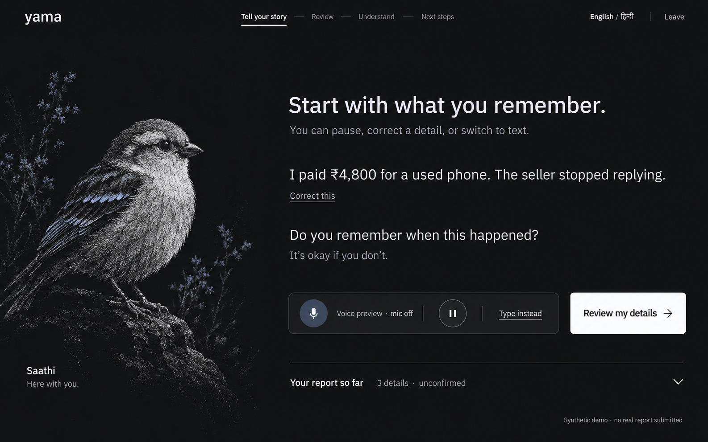
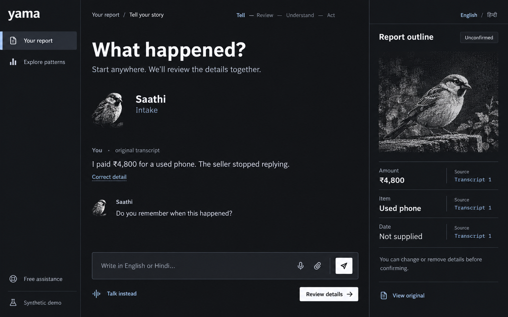

# Yama — visual direction studies, v2

Historical proposal. The user subsequently rated this direction 6/10 and still generic. See `visual-direction-v3.md` for the current proposal using BeautifulUI as the AI-component reference.

2026-10-07. The user rated the initial proposal 3/10, rejected its colour, typography, and component treatment, and selected **dark, expressive, dithered**. This document replaces the earlier visual recommendation. The report journey, runtime choices, privacy requirements, and business model remain the accepted product foundation.

## Diagnosis of the first pass

The interface used pastel green and generic geometric type without a clear connection to Yama. Similar rounded containers and repetitive labels made almost every piece of content carry the same emphasis. The opening looked like a generic landing page, while the agent artwork was reduced to a small toolkit sample and letter placeholders. The previous preview used hand-styled controls; component sources were inspected, but beUI components were not actually imported.

The reset changes composition, information hierarchy, component proportions, and the role of art. It is not a theme swap on the old markup.

## Confirmed direction and proposed visual system

- **Theme:** dark, explicitly chosen by the user. Design scene: someone at home in subdued light, trying to put a difficult account into words. The initial intake reduces visual competition; detailed review exposes more structure as needed.
- **Colour:** carbon `#111214`, graphite `#1b1d20`, silver `#eceef1`, secondary text `#a8abb2`, structural line `#383b42`, steel blue `#a7b9d8`. White is the primary action surface. The blue appears on current state and interactive references, with text labels. No mint or saturated neon accent. Implementation tokens should express these roles in OKLCH.
- **Type:** IBM Plex Sans for task headings, conversation, labels, and controls; IBM Plex Sans Devanagari for Hindi; IBM Plex Mono only for compact source identifiers. One coherent family with role-specific weights and a compact product scale. Avoid marketing-scale headings, excessive tracking, or novelty fonts in fields. [IBM's typeface repository](https://github.com/IBM/plex) documents UI use, Devanagari support, and the Open Font License.
- **Components:** approximately 4px control corners, consistent height/padding, purposeful whitespace, subtle separators, one white primary action per task. Native-looking fields with clear borders. Surface boundaries organize content rather than decorate every paragraph.
- **Signature:** an expressive dithered companion integrated into the scene. Text and evidence remain sharp. The sparrow in the studies is an artwork exploration, not an approved mascot. Saathi, Drishti, and Disha still require their own related identities and state poses.

## Stage



An intimate intake layout. The companion occupies one side; the story and a single follow-up question occupy the other. A small voice console carries the actual microphone status. The report outline is accessible through a quiet row beneath the conversation rather than competing with every utterance.

```text
wordmark         current task / remaining journey          language / leave

dithered companion             task heading
                               original statement + correction
                               one follow-up question
                               voice or text control + review action

                               report outline disclosure
```

This is the stronger opening direction: it gives Yama a recognizable character while keeping the user's next action clear. After intake, the original source remains available and the report outline expands into editable assertions. On mobile the companion becomes a compact identity treatment; the task and transcript keep priority. Large art cannot push the recording, correction, or assistance controls out of reach.

## Desk



A report workspace. Navigation sits at the edge, the conversation reads like a working document, and the inspector holds organized details with source references. Unboxed messages, restrained separators, a single composer, and compact controls create a more useful dense state than a stack of similar cards.

```text
navigation       conversation notebook                     report inspector
                 working title                             confirmation state
                 original statement / correction           assertion rows
                 follow-up question                        original sources
                 text composer / review action             edit / remove
```

This structure is useful for review, evidence, and comparison, when the user has more material to inspect. On mobile the inspector becomes a full-width section after the current task, or a deliberate detail view. Navigation remains recognizable as the layout becomes denser.

## Recommendation for the journey

Use **Stage for intake and Desk's document/inspector structure for review**, with shared typography, control shapes, colours, and navigation. Do not turn the handoff into an unrelated second app.

| Task | Visual treatment |
| --- | --- |
| Start / Saathi | Dithered companion, one direct invitation, voice/text choice. Minimal chrome rather than a marketing hero. |
| Narrate | Readable utterances and a single contextual prompt. Mic status is explicit; pause, correction, and text fallback stay available. |
| Review / evidence | Editable document with an inspector. Original and corrected versions remain distinguishable. File upload and extraction have separate states. |
| Confirm | A clear commitment action after assertion review. Confirmation is not represented as independent verification. |
| Connect | Keep the report visible while real phases are announced. The agent changes state; report text does not dissolve into particles. |
| Understand | Findings and supporting/contradictory facts first, graph on demand. Drishti artwork becomes secondary at this reading-intensive stage. |
| Act | Disha introduces a concise action list. Essential assistance and the user's account occupy the main area; optional purchase information is secondary. |
| Checkout / public exploration | The same control/type vocabulary. Explicit purchase verification and dataset provenance; no celebratory animation before the application state supports it. |

## Component source decision

The [beUI base button](https://beui.dev/components/motion/button) was retrieved through the MCP and inspected. It supports primary/secondary/ghost/outline variants, custom classes, press scale, reduced motion, and optional ripples. Its default small/medium/large sizes use pill corners; importing those defaults unchanged would conflict with this proposal. Adapt corner, spacing, type, and motion consistently. Use a subtle press response; keep decorative ripple, magnetic, and metallic variants out of essential controls.

Use beUI for appropriate behavior and composition, then apply the Yama system across button, controlled prompt input, messages, file upload, and safe image viewing. The source review's constraints still apply: do not use timer-driven attachment success, force readers to the live edge, or announce every streaming token. ForgeUI remains a reference for craftsmanship and visual energy; it is not the product's token system or a substitute for real application state.

## Status and limits

These are two high-fidelity **generated visual direction probes**, not implemented screens. Built-in image generation produced the studies; they have not passed responsive or accessibility testing. Typeface rendering in a generated image is illustrative. Exact font files and token contrast must be checked in the actual frontend. Generated copy/metadata are not a source of application truth: for example, an unsupplied date must not receive a fabricated transcript citation.

The avatar texture in these studies illustrates the direction; it is not a new verified ASCII Magic recipe. Production artwork will use the configured ASCII Magic pipeline with static fallbacks and bounded state animation. Preserve transcript position, focus, evidence legibility, and reduced-motion behavior.

The images and exact prompt set are saved in `docs/design/stage-direction.png`, `docs/design/desk-direction.png`, and `docs/design/direction-prompts.json`. No application code, imports, databases, voice requests, or payments were changed. Selection between the studies is pending user review. The rejected first preview and its verification records are preserved as historical work.
